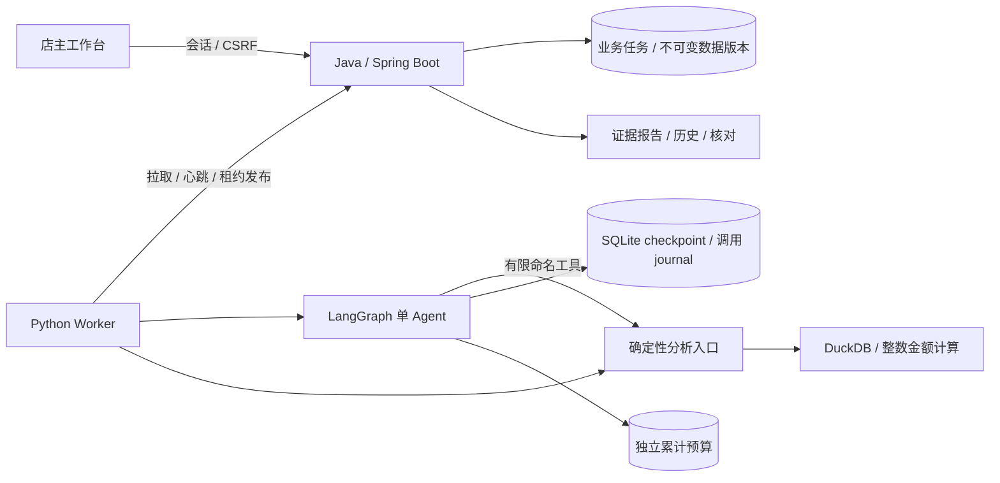

# Commerce Insight · 电商经营分析助手

**Java 业务后端 + Python LangGraph + DuckDB：把订单与售后数据变成可核查的分析报告。**

导入 CSV、确认字段和金额口径，再分析销售变化、退款变化或核对两份报表。每个数字来自确定性查询，报告保留数据版本、参数、SQL 与证据；数据不够时限制能力或要求补充。

这是一个面向 Agent 应用与后端工程的个人项目，使用公开/合成数据验证。当前没有真实商家试用或公网服务，不宣称经营收益或生产规模。

## 可以做什么

| 功能 | 输出与边界 |
| --- | --- |
| 外部账本导入 | 订单/明细/退款 CSV，字段、状态、金额单位、时区映射；质量检查与人工确认；不可变数据版本 |
| 销售变化分析 | 两期已支付金额及商品增减贡献，剩余贡献与总额勾稽；不把相关性写成经营因果 |
| 退款变化定位 | 按退款发生期比较，区分退款记录/订单、原支付时间、已知商品归属与未归属金额 |
| 报表差异核对 | 结构化声明确认后按授权快照重算，区分口径差异、可解释变化与未解释偏差 |
| 自然语言分析 | 受控工具调用、结构化决策、证据校验；明确回答、澄清或不支持 |
| 任务与工作台 | 进度、取消、历史、导出、单店主登录；幂等、租约、恢复、截止与限额 |

例如，合成账本中两周销售额 **280 → 150 元**，分解为 **P3 −100、P2 −40、P1 +10 元**。这说明变化集中在哪些商品，不证明为什么发生变化。

## 架构与取舍



Java 管业务身份、数据确认、持久任务与结果发布；Python 管模型调用、图执行与工具。业务数据库支持本地 H2 和 PostgreSQL/Flyway。模型没有任意 SQL、Shell、文件路径或业务写权限。

通信采用 HTTP JSON + 数据库任务队列，验证幂等、租约 fencing 和故障恢复。当前单实例无需引入 Kafka/Kubernetes；扩容需要重新设计 checkpoint、预算与 Worker 身份。

默认是**完整上下文单 Agent**。artifact 摘要与固定销售/退款双专家是研究候选，已有受控对照入口，但真实模型对照未完成，因此没有宣称多 Agent 更好。参见 [架构决策](docs/adr/003-langgraph-single-agent.md) 与 [上下文实验](experiments/context-evaluation/README.md)。

## 已验证到哪里

| 证据 | 实际结果 | 不代表什么 |
| --- | --- | --- |
| Java/Worker/LangGraph 工程回归 | 最近 42/42，真实 JVM、HTTP、DuckDB、checkpoint；模型为脚本/HTTP Mock | 不是模型准确率 |
| 历史销售真实模型评测 | 9 道不同合成题、15 次任务；开发 3/3，保留集两轮各 6/6；15 份报告重算无数字/引用错误 | 仅阶段 2h 版本、小样本；不覆盖最新退款或复杂对照 |
| 备份与部署配置 | PostgreSQL/受限角色/跨状态恢复/启动器/configtree 5/5 | 不支持高可用、热备或多活 |
| 实际 TLS 链路 | Caddy 2.11.9 登录、CSRF、任务、退出与内部路由隔离 3/3 | 尚未验证公网域名或 ACME 续期 |
| Docker / 干净 Linux | 个人 hosted CI 实际构建；空卷启动、TLS 登录/分析/重启及独立空卷备份恢复通过；恢复验证报告、排队任务、checkpoint 和合成预算 | 不等于公网服务、高可用或付费模型验收 |

套件有继承和重叠，不把各阶段测试数相加当作独立用例数。原始失败、修正和前后对照保留在 [阶段索引](docs/completion-plan.md)。

2026-11-09 已发布到个人 GitHub；[干净 Linux CI](https://github.com/hhh-hhh139/commerce-insight/actions/runs/42557209900) 对应用提交 `8855db6` 验收通过。前三轮失败、局部修复、镜像 digest 与实际结果见 [阶段 5f](docs/baselines/phase-05f-2026-11-09.md)。

后续提交 `3eed114` 的[独立容器恢复 CI](https://github.com/hhh-hhh139/commerce-insight/actions/runs/42584328249)也已通过：9 个状态文件哈希一致、待处理任务仅一次成功、检查点续跑及重放不新增调用、已知与未知预算记录保留。调研、前后对比、复现和局限见 [阶段 5g](docs/baselines/phase-05g-2026-11-09.md)。本轮使用合成数据和脚本模型。

最新真实模型验收首题未获得 usage，架构比较没有开始。原 5 元账本的保守占用为 **4.525418 元**，含两笔未知预占；这不是实际账单。用户决定暂缓核账，继续不依赖模型费用的开发；没有重置预算或继续自动消费。详见 [故障与修复](docs/baselines/phase-04b-2026-11-08.md)。

## 本机运行

以下命令在本仓库执行，使用个人环境。已验收平台是 macOS ARM64，Python 3.12.16 / Java 21.0.13；其他平台以实际 CI 记录为准。Java/Maven bootstrap 仅写本项目 `.local`。

```sh
python3.12 -m venv .local/agent-venv
PIP_CONFIG_FILE=/dev/null .local/agent-venv/bin/python -m pip --isolated install \
  --index-url https://pypi.org/simple --cache-dir .local/pip-cache \
  --only-binary=:all: --require-hashes -r requirements-agent.lock
.local/agent-venv/bin/python scripts/bootstrap_java.py
.local/agent-venv/bin/python scripts/java_local.py build
.local/agent-venv/bin/python scripts/web_demo.py
```

打开 <http://127.0.0.1:18080/demo/index.html>。默认无需模型 Key、无付费调用，可以导入合成样例、运行分析、核查证据与历史。Ctrl+C 关闭本次服务。这个免登录入口只监听回环，不用于公网。

需要登录保护时：

```sh
.local/agent-venv/bin/python scripts/prepare_owner.py
.local/agent-venv/bin/python scripts/web_demo.py --owner
```

密码在终端隐藏输入，账户名 `owner`；它与 GitHub/模型账户无关。PostgreSQL、备份恢复和 TLS 见 [部署手册](docs/deployment.md)。容器默认离线，已完成上述 Linux 工程验收；实时模型仍走个人终端和原预算入口。

自然语言实时入口需要个人终端显式开启、有效价格校验和原累计预算；Key 不通过聊天、配置文件或仓库传递。导入版本还需单独允许模型使用。当前预算待核对，不建议反复运行付费评测。见 [模型运行与评测说明](experiments/single-agent/README.md)。

## 演示与复现

- [5 分钟演示与面试主线](docs/project-story.md)：问题、取舍、实现、证据、局限。
- [CSV 导入闭环](experiments/data-import/README.md)；[销售变化](experiments/sales-change/README.md)；[退款变化](experiments/refund-change/README.md)；[报表核对](experiments/report-reconciliation/README.md)。
- [任务协议与故障验证](experiments/task-loop/README.md)；[单 Agent](experiments/single-agent/README.md)；[身份认证](experiments/owner-access/README.md)。
- [整体计划与进度](docs/project-plan.md)；[调研/决策/实验产物索引](docs/completion-plan.md)；[官方 JD 能力映射](docs/job-alignment-2026-11-05.md)。
- [独立试用方案与反馈模板](docs/trial-protocol.md)；[个人发布与 CI 说明](docs/personal-publication.md)。

先构建 jar 后，可运行原有离线任务回归（不需要 API Key）：

```sh
.local/agent-venv/bin/python experiments/single-agent/verify.py .local/agent-check.json
```

## 数据、许可与限制

本项目代码和合成样例使用 [MIT](LICENSE)。依赖保留原许可，详见 [第三方声明](THIRD_PARTY_NOTICES.md) 和 [实际依赖清单](docs/dependency-licenses.json)。UCI Online Retail 独立实验采用 CC BY 4.0 并保留署名，原始数据不进入 Git 或镜像；[来源与加工说明](docs/data-sources.md)。

目前限定单店主、单币种、有限账本口径和显式映射。没有任意 Excel/任意行业自动分析、利润/ROI 计算、因果诊断、自动经营操作、多租户或生产 SLA。退款新提示与候选专家流程的真实模型效果、独立试用者反馈仍待验证。
