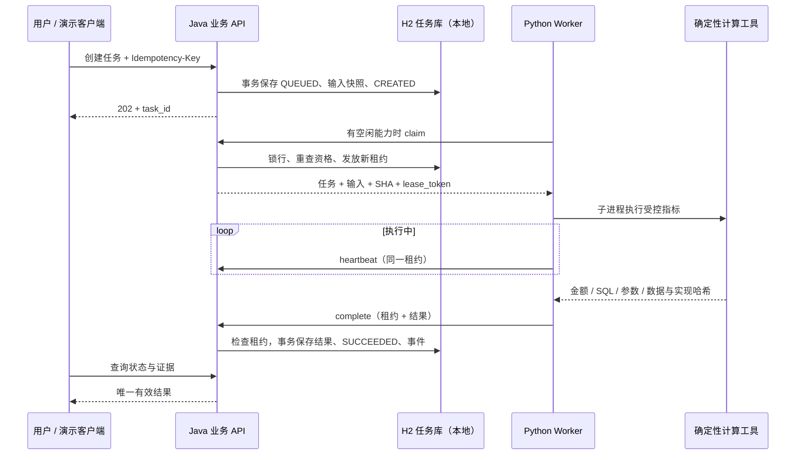

# ADR 002：HTTP JSON 与 Java 持久化任务领取

日期：2026-11-06。状态：接受，用于当前本地单实例、只读分析切片。研究与验收条件见 [模块研究](../research/003-task-loop.md)，实测见 [阶段实验](../probes/task-loop-2026-11-06.md)。

## 决策

采用 Java 21 / Spring Boot 4.1.2 业务 API；Python Worker 通过 HTTP JSON 拉取任务。Java 保存任务、冻结的数据输入、租约、结果与审计，Python 只负责执行。H2 2.4.240 文件模式支撑本地单 Java 实例；生产 PostgreSQL 选型和测试尚未完成。

## 选择理由

当前没有跨服务补偿、人审长时间等待或高吞吐要求。同步请求不能承担恢复语义，内存队列不能承受重启；先使用数据库事务统一任务和调度状态，可避免业务库与消息发布的双写窗口。HTTP/JSON 便于跨语言检查协议，尚无证据支持改用 gRPC。

RabbitMQ、Temporal、Agent Server 都有实际价值，详见研究中的官方资料和比较。选择当前方案不是断言它们性能差或无法适配，而是将自写范围限制为一个可测的业务任务生命周期。Spring MVC、Jackson、JDBC/HikariCP 和 H2 承担 HTTP、JSON、连接池和事务；不写自己的消息代理、工作流重放引擎或通用 DAG 平台。

本方案确实承担了租约、取消、幂等代码的维护成本；因此必须保留故障验收。能否减少维护成本是未来采用现成调度平台的重要重评因素，不能为了展示技术而永久保留自写调度。

## 关键不变量

1. 同工作空间同幂等 key 绑定同一规范化请求；唯一约束处理并发插入，冲突请求不能覆盖原任务。
2. 每条任务只有一个当前租约。领取、续租、完成、失败、取消都在事务行锁内检查；候选扫描不等于领取成功。
3. 租约过期/更换或取消后，旧执行失去发布权。取消与完成竞争，先提交者决定终态。
4. 成功结果、终态与审计事件在同一事务提交；响应丢失后用同租约、同规范化 JSON 重传，不产生第二条成功发布事件。
5. 执行可以重复，当前仅允许只读计算。不能把一个有效发布写成“全链路 exactly-once”。
6. 每个任务保存创建时的输入 bytes 和 SHA；后续注册数据改变不影响旧任务。Java 校验结果与任务的范围、版本及证据绑定，数学计算仍由 Python 工具负责。
7. 身份和工作空间在 Java 检查，不信任自然语言/模型声明；Worker 不访问业务数据库。

## 代价与重选条件

轮询带来空请求与启动延迟，任务表有数据库写压力；快照每任务保存一份仅适合当前小样例，正式数据集应改为不可变版本引用。单 JVM H2 无主机级高可用。schema.sql 只有初始建表，不能代替版本迁移。

部署多 Java 实例前：迁移到实际 PostgreSQL、引入版本化迁移，重新运行真实数据库并发/恢复用例。出现积压或多类消费者时：用测量决定是否 RabbitMQ + outbox。出现跨服务长流程、补偿/长等待时：比较 Temporal。正式 LangGraph 托管运行时：再次比较 Agent Server 的 run/queue 能力和 Java 任务映射。不要假设 LangGraph checkpoint 可以替代业务发布授权。

回退：旧 Python CLI 入口及全部数据契约保持可用；停止本轮 Java/Worker 进程即可回到本地指标工具。源码可从改造前快照恢复，无需改动旧金融项目、公司仓库或全局环境。

## 面试可复述版本

“我先做了可靠的确定性指标工具，再把它接进 Java 和 Python 的异步任务闭环。调研发现消息确认与业务结果幂等是不同的问题，因此当前小规模只读场景选择 Java 持久化任务加 Python 拉取。任务领取带租约，状态和结果在事务中提交；过期执行不能回写，结果响应丢失可幂等重传。我用真实 JVM、HTTP、Python 和文件数据库验证并发、强制退出、取消、超时和重启，最终 18 组验收通过。当前结论限于本地 H2 单实例，还没有声称生产高可用或模型效果。”
