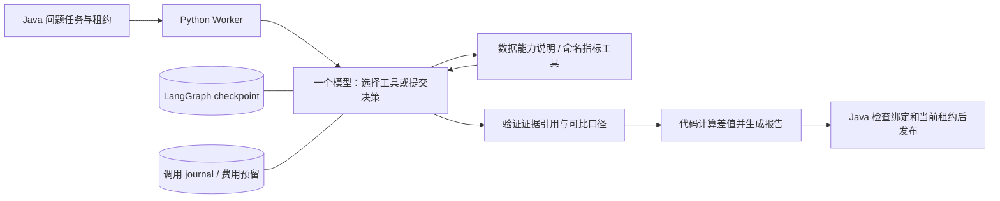

# ADR 003：以 create_agent 接入 LangGraph 单 Agent

日期：2026-11-06。状态：工程接入接受；真实模型质量验收单独记录。依据见 [实施前调研](../research/004-single-agent.md)。

## 决策与职责

使用 LangChain 1.4.9 的 create_agent 生成 LangGraph 1.2.20 运行图。没有改成 Java Agent，也没有把每个确定性节点称作一个 Agent。一个模型在受控工具和结构化输出协议内反复决策，仍是单 Agent。

LangGraph 保存图运行进度，Java 保存业务任务。checkpoint 恢复不等于拥有发布权；费用预留也不能依赖模型调用完成后的 checkpoint。分别解决状态恢复、授权和付费请求不确定性。

## 为什么不直接手写图或工具循环

当前核心是标准“模型→工具→模型”循环。create_agent 已提供结构化输出、工具错误反馈、次数 middleware 和 LangGraph checkpointer；自写这些内容不会增加已证明的业务价值。手工 StateGraph 保留为未来组合明确校验分支/人审的选择。

直接一次模型提取参数适合明确单指标请求，原确定性 API 也继续保留。本轮循环额外支持观察工具失败后修正参数、或判断数据不足；没有进行真实模型架构 A/B，因此不能声称该循环比一次提取准确率更高。

Dify 的工具定义和最大迭代数、Deep Agents 的分层能力提供了参考。没有引入完整低代码平台、文件系统工具或子 Agent，因为当前任务仍限制在已注册快照的有限指标。多 Agent 必须在后续同模型、同工具、同预算对照后决定。

## 工具与报告边界

只有 inspect_dataset 和 query_metric 两个业务工具，后者提供 8 种已验收命名指标。工作空间、数据文件和连接由运行时绑定，工具 schema 不提供这些参数。输入模型是提示词加问题、必要元信息和聚合结果，不开放任意 SQL 或 Python 执行。

最终 AnalysisDecision 只选择 outcome、真实 evidence_id、比较引用和有限 issue。金额、差值、变化率由工具与代码生成；模板不会接受模型自由编造的数字或因果句子。代价是表达范围有限，暂时不能生成开放式经营分析长文。

模型选择了错误指标仍可能得到数学上正确的数字。因此“工具结果正确”“任务问题答对”“能帮助真实用户”是三层不同结论，分别用确定性测试、真实模型题集和后续试用验证。

## 恢复策略

本机每个逻辑任务有独立 SQLite checkpoint、执行 journal 和文件锁。线程标识是绑定 task_id、数据 SHA、规范化请求 SHA、提示词、实现、依赖和模式的摘要。单任务写锁阻止过期执行与新租约同时修改同一 checkpoint。新执行可从保存的图状态继续；发布时仍需当前 Java 租约。

sync durability 保证进入下一步前提交 checkpoint，不保证外部调用恰好一次。模型请求前独立落盘调用计数和费用预留，响应未知保留最大预留。原生 middleware 与 journal 双重限制 5 次模型尝试、4 次业务工具调用。此上限跨同一逻辑任务的恢复保持，不随着 Java attempt 自动重置。

这里承担了本地锁与业务预算的维护成本；没有实现分布式 checkpoint 协调。多机部署前必须改用受控数据库/调度方案并重新做并发与故障验收。

## 验证与面试表达

离线验收实际运行 LangGraph、JVM、DuckDB 和 HTTP，但模型由脚本或 HTTP Mock 代替；该结果只证明工程行为。真实 DeepSeek 题集含独立保留问题族与两轮重复，预算合计不超过用户授权的 5 元。结果见阶段记录，不预填成功率。

可复述：“我复用了 LangGraph 的成熟工具循环，重点设计模型决策与确定性计算之间的边界。模型只能选择命名指标和引用工具证据，金额和差值由代码生成。Java 负责任务发布权，LangGraph 负责图状态，独立费用账本处理请求超时后的收费不确定性。工程故障测试和真实模型正确率分开评估，不能用脚本回放冒充模型能力。”
